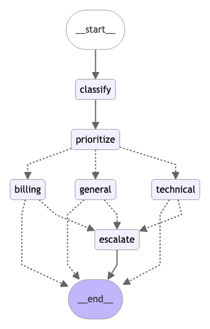

# EXER026 — LangGraph Basics

**Module 5 · Agents with LangGraph** · Lecture: [Lecture/lectures/lec026.html](../Lecture/lectures/lec026.html)

## Goal

Learn LangGraph's building blocks without an LLM in the way: state, reducers,
nodes, normal edges, conditional edges, streaming, and drawing the graph.

## The project

A support-ticket router: classify → prioritize → route to a handler →
escalate if urgent.

```
START → classify → prioritize ─┬→ billing   ─┬→ escalate → END
                               ├→ technical ─┤
                               └→ general   ─┴→ END
```

## Tasks

Complete the TODOs in `starter/ticket_graph.py`: the `steps` reducer,
`classify`, `prioritize`, both routers, and `build_graph`.

## Run it

```bash
uv run python EXER026/starter/ticket_graph.py
uv run python EXER026/check.py
```

## Success criteria

- [ ] The script prints a Mermaid diagram of your graph
- [ ] `steps` shows the exact path each ticket took
- [ ] Urgent tickets pass through `escalate`; normal ones don't
- [ ] All 6 checks pass (offline)

## Stretch goals

Optional. Neither goal is needed to complete the exercise, and `check.py` must still pass when you are done.

1. **Extend.** Add a node that asks the user for missing information and loops back, at most twice. *Done when:* a ticket such as `Help!` passes through `ask_details`, and a ticket that never becomes clear still ends.
2. **Connect (EXER027).** Draw the graph to a PNG and add it to this README. *Done when:* the picture shows the same nodes and edges as the diagram in the lecture. The reference: .

Reference code, for after you have tried (it builds on `solution/` and changes nothing in it):

```bash
uv run python EXER026/stretch/goal1_ask_for_details.py
uv run python EXER026/stretch/goal2_graph_png.py
```

Also in [stretch/](stretch/): `ticket_graph.png`.
